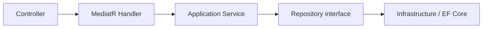

# معماری بک‌اند دمِ دست

بک‌اند .NET با Controllerهای ASP.NET Core و MediatR بازآرایی شده است. مسیرهای API، شکل JSON، نام کوکی، کلیدهای IndexedDB و قالب رکوردها حفظ شده‌اند. زنجیرهٔ migrationها اکنون مخصوص PostgreSQL است و دادهٔ SQLite قبلی با ابزار انتقال وارد می‌شود. این تغییر مربوط به نسخه کامل .NET است؛ نسخه میزبانی‌شده خصوصی همچنان Worker جداگانه خود را دارد.



## مسئولیت لایه‌ها

| لایه | مسئولیت |
| --- | --- |
| Web | Controllerها، احراز هویت Google/Cookie، استخراج هویت کاربر، CSRF، مدیریت پاسخ خطا، فایل‌های PWA |
| Application | Use caseها، Command/Query/Handler، قرارداد سرویس‌ها و Repositoryها، Pipeline Behavior و منطق هماهنگی یادآوری |
| Domain | مدل‌ها، قواعد مالی، نسخه و اعتبار رکوردها ، چک‌لیست و قواعد تکرار یادآور/سررسید اقساط |
| Infrastructure | پیاده‌سازی Repository با EF Core/PostgreSQL، سرویس قیمت، Web Push، فایل کلیدها و Background Worker |
| Common | ابزارهای زمان TimeProvider، زمان تهران و تقویم شمسی |

## پوشه‌بندی

در Application قراردادها زیر `Interfaces/{Entity}` قرار دارند: FinanceRecords، Notes، Goals، Reminders، Portfolio، Market، Benchmarks، Sessions و Common. همه پیاده‌سازی سرویس‌های کاربردی در پوشه مشترک `Services` هستند. `Features/{Entity}` فقط Command، Query، Handler، Model و Validation موردنیاز را نگه می‌دارد. Handler می‌تواند یک یا چند سرویس مصرف کند؛ `GetOrganizerQueryHandler` یک‌بار دفتر را می‌خواند و خروجی سرویس یادداشت، هدف و یادآور را ترکیب می‌کند. هیچ Handler وابسته به کلاس concrete سرویس یا Repository زیرساخت نیست.

مدل‌های دامنه در پوشه‌های مستقل Accounts، Transactions، Budgets، Goals، Installments، Receivables، LockedAssets، Categories، Notes، MonthlyExpenses، Allocations، Investments و Benchmarks قرار گرفته‌اند. نام عمومی و JSON آنها عوض نشده است.

در این برنامه، `FinanceRecord` مرز دفتر مالی و همگام‌سازی است. حساب، تراکنش، بودجه و دیگر رکوردهای محلی در یک batch اتمیک همگام می‌شوند؛ به همین دلیل Repository عمومی برای هر DTO ساخته نشده است. Application برای این Aggregate از `IFinanceRepository` استفاده می‌کند تا یک تغییر چندرکوردی همچنان در یک تراکنش ذخیره شود. فهرست واردشده از افزونه Use case و سرویس Portfolio جدا دارد و فقط externalSnapshot را می‌پذیرد.

## قراردادها و Behaviorها

- `IFinanceService` و `IPortfolioService` سرویس‌های کاربردی دفتر و تجمیع هستند.
- `IMarketService`، `IBenchmarkService` و `IPushGateway` قرارداد قابلیت‌های بیرونی‌اند؛ پیاده‌سازی آنها در Infrastructure است.
- `INoteService`، `IGoalService` و `IPersonalReminderService` انتخاب کارها، سنجاق‌ها و اعلان‌های برنامه‌ریز را انجام می‌دهند.
- `IPushSubscriptionService` و `IReminderService` منطق عضویت اعلان و انتخاب اقساط قابل یادآوری را نگه می‌دارند.
- Repositoryهای اختصاصی `IFinanceRepository`، `IMarketSampleRepository`، `IPushSubscriptionRepository` و `IReminderReceiptRepository` هیچ DbContext، DbSet یا IQueryable به Application نمی‌دهند.
- `AuthorizationBehavior` از `IPipelineBehavior` درخواست‌های شخصی را بررسی می‌کند. شناسه کاربر از `ICurrentUser` در Web می‌آید و در بدنه Command قابل تعیین نیست. کنترلرها هم `[Authorize]` دارند.
- `ValidationBehavior` قراردادهای `IRequestValidator<TRequest>` را اجرا می‌کند. batch خالی، بیش از ۱۰۰ تغییر یا OperationId تکراری پیش از رسیدن به سرویس و دیتابیس رد می‌شود. قواعد مالی و تعارض نسخه همچنان در Domain و Repository اعمال می‌شوند.

CSRF جزو مرز HTTP است و در یک Filter مشترک برای متدهای تغییردهنده بررسی می‌شود. اطلاعات نشست، کلید اعلان، قیمت‌ها و همگام‌سازی با MediatR به Application می‌روند. عملیات خود پروتکل Google/Cookie و Health در Web می‌مانند.

## اصول پیاده‌سازی

Controllerها منطق مالی، EF و SQL ندارند. Application به Infrastructure و ASP.NET Core ارجاع ندارد. ثبت وابستگی‌ها در `AddApplication`، `AddInfrastructure` و `AddPresentation` جداست و Program فقط pipeline و راه‌اندازی را ترکیب می‌کند. افزودن سرویس یا Repository جدید از طریق قرارداد انجام می‌شود؛ Generic Repository با قابلیت دلخواه یا واسط خالی برای همه کلاس‌ها اضافه نشده است.

همه عملیات async دارای API قابل لغو، CancellationToken را تا MediatR، سرویس، Repository، EF و HttpClient منتقل می‌کنند. دسترسی به ساعت در کد جدید از TimeProvider و ابزارهای Common انجام می‌شود. کد از primary constructor، record، pattern matching، collection expression و guard clause در موارد مناسب استفاده می‌کند. Handlerها سرویس را فراخوانی می‌کنند؛ زنجیره‌ای از Commandهای داخلی برای اجرای یک عملیات ایجاد نشده است.

## دیتابیس، تراکنش و Worker

جدول `FinanceRecords` رکوردهای مستقل را با کلید مرکب کاربر/رکورد نگه می‌دارد و `Ledgers` فقط نسخه و زمان تغییر دفتر است. migrationها و snapshot مخصوص PostgreSQL هستند. داده‌های SQLite قبلی با ابزار جداگانه منتقل می‌شوند و کلیدهای نصب قبلی حفظ می‌شوند. تنظیمات جدول‌ها، نگاشت رکورد و سیاست retry مسئولیت‌های مستقل دارند. `FinanceRepository` تراکنش batch، Revision و رسید OperationId را حفظ می‌کند. در تعارض 409 برمی‌گردد و تغییرات قبلی batch نیمه‌کاره ثبت نمی‌شوند.

ReminderWorker در Infrastructure هر دقیقه فقط زمان‌بندی را انجام می‌دهد و برای هر دور یک scope جدید می‌سازد. سرویس scoped یادآوری با Repositoryها کار می‌کند و ارسال واقعی پشت IPushGateway است. دریافت HTTP یا ارسال Push داخل تراکنش دفتر مالی نگه داشته نمی‌شود. بازه روزانه اقساط تهران، پیام عمومی بدون مبلغ/نام وام، رسید روزانه اقساط هر دستگاه و حذف اشتراک منقضی حفظ شده‌اند. یادآور شخصی در ساعت‌های انتخابی تهران و با رسید مستقل هر نوبت اجرا می‌شود. برای توضیح رفتار و ذخیره‌سازی برنامه‌ریز و بازار [این راهنما](ORGANIZER-MARKETS-fa.md) را ببین.

اتصال PostgreSQL از `ConnectionStrings:Finance` یا `ConnectionStrings__Finance` و کلیدها از `data/keys` خوانده می‌شوند. مقدار اختیاری `Storage:DataDirectory` ریشه مسیر کلیدها را مشخص می‌کند. دیتابیس در Docker volume جدا دارد؛ volume پوشه data نیز برای کلیدها حفظ می‌شود. تست‌های HTTP دیتابیس PostgreSQL و مسیر کلید مستقل دارند. [راه‌اندازی و انتقال](POSTGRESQL-fa.md).

## بسته‌ها و اجرا

پروژه با .NET 10 و پکیج رسمی MediatR نسخه 12.5.0 ساخته می‌شود. این نسخه عمداً pin شده و مجوز آن Apache-2.0 است؛ ارتقای عمده MediatR باید همراه بررسی مجوز و سازگاری انجام شود. منبع نسخه پین‌شده: [NuGet](https://www.nuget.org/packages/MediatR/12.5.0) و [توضیح سازنده درباره نسخه‌های پیشین](https://luckypennysoftware.com/faq). به جای کپی‌کردن یک mediator سفارشی، DI و IPipelineBehavior خود پکیج استفاده شده‌اند.

```bash
dotnet restore
dotnet test tests/DameDast.Tests/DameDast.Tests.csproj
dotnet run --project src/DameDast.Web --environment ASPNETCORE_ENVIRONMENT=Development
```

تست‌ها مرز وابستگی لایه‌ها، اجرای Controller از مسیر MediatR، جلوگیری از دور زدن احراز هویت در Application، اعتبار batch پیش از نوشتن، انتقال CancellationToken، مسیر قیمت‌ها بدون شبکه واقعی، CSRF و جداسازی مالک اشتراک اعلان، عدم نیاز به Migration و رفتار قبلی تراکنش/تعارض/همگام‌سازی را بررسی می‌کنند. ورود واقعی Google و تحویل واقعی Push در محیط شخصی نیازمند تنظیم و بررسی همان نصب هستند.

آیکون دست در SVG اصلی، PNGهای ۱۹۲/۵۱۲، نسخه maskable، لوگوی داخل PWA و آیکون افزونه یکسان است. کش پوسته نسخه جدید دارد؛ برای دیدن فایل‌های تازه تب‌های قبلی را ببند و دوباره باز کن. تغییر آیکون نصب‌شده ممکن است به زمان به‌روزرسانی سیستم عامل وابسته باشد.
